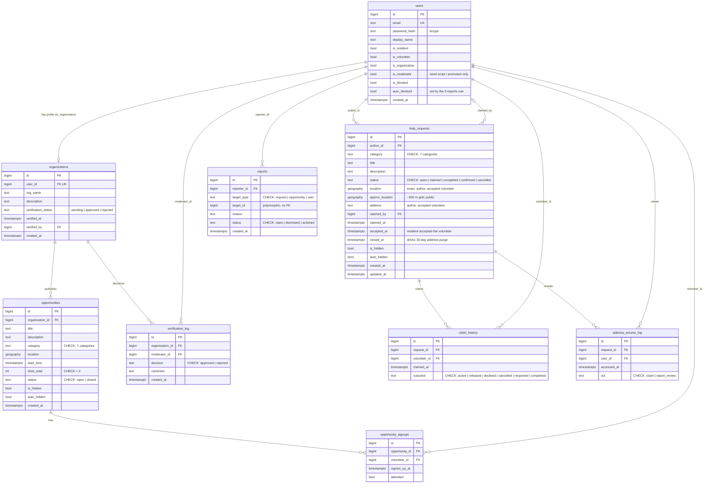

# Razom — ER diagram (Beta)

Schema as created by the Alembic migrations in `backend/app/migrations/versions/` (0001 baseline, 0002 Beta, 0003 review fixes). PostgreSQL 16 + PostGIS; `geography(Point, 4326)` columns have GiST indexes.

Image version: [`ER.png`](./ER.png) (rendered from the diagram below).

## Constraints and indexes that enforce rules

| Rule | Enforced by |
|---|---|
| One account per email | `users.email` UNIQUE (lowercased by the API) |
| One profile per organization account | `organizations.user_id` UNIQUE |
| No double sign-up | UNIQUE `(opportunity_id, volunteer_id)` |
| One report per user per target | UNIQUE `(reporter_id, target_type, target_id)` |
| Claimed/completed request has a volunteer | `chk_claim_consistency` |
| Only a claimed request can be accepted | `chk_accept_needs_claimer` |
| Valid statuses, categories, decisions | CHECK constraints listed above |
| Fast radius search | GiST on `help_requests.location`, `approx_location`, `opportunities.location` |
| Fast limits and lists | B-tree on `help_requests(author_id)`, `(claimed_by)`, `(status) WHERE NOT is_hidden`, `claim_history(volunteer_id, claimed_at)`, `address_access_log(request_id, accessed_at)`, `reports(target_type, target_id, status)`, `opportunities(start_time) WHERE NOT is_hidden` |

**Changes since the Alpha:**
- New tables `claim_history` and `address_access_log`.
- `help_requests` gains `accepted_at`, `closed_at`, `is_hidden` and `auto_hidden`.
- `opportunities` gains `category`, `is_hidden` and `auto_hidden`.
- `users` gains `auto_blocked`; `users.phone` was removed because it was collected but never used.
